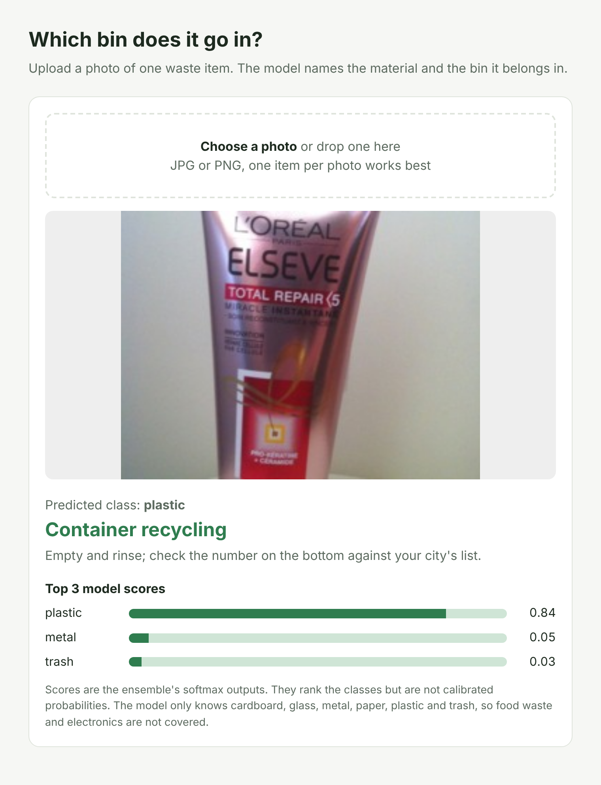

# Which bin does it go in? A waste-sorting image classifier

Final project for TME 6015 (AI/ML Workflow Design), University of New Brunswick. Author: Ali Rizvi.

Take a photo of one waste item. The model names the material (cardboard, glass, metal, paper, plastic or trash) and a small downstream app turns that into the bin the item goes in.



## Results at a glance

Final model: an ensemble of EfficientNet-B0 and MobileNetV3-Large (mean of their softmax outputs), both fine-tuned from ImageNet weights on real photos plus synthetic-background images. Input 192 x 256 pixels, whole photo (no segmentation).

| evaluation set | n | accuracy (95% interval) | macro-F1 | worst-class recall |
|---|---|---|---|---|
| TrashNet test photos | 375 | 0.912 (0.879 to 0.937) | 0.883 | 0.55 (trash, n=20) |
| External test set (Garbage Dataset photos held out from training) | 480 | 0.933 (0.907 to 0.952) | 0.933 | 0.90 (paper) |
| TrashNet test photos on new synthetic backgrounds | 162 | 0.710 (0.636 to 0.774) | 0.673 | 0.46 (cardboard, n=13) |

Published results on the same datasets, for context: pretrained GoogLeNet on TrashNet 0.912 (0.954 with augmentation) with a random 10% hold-out ([Yu & Grammenos](https://arxiv.org/abs/2108.06274)); 0.93 to 0.96 for ResNet / EfficientNetV2 on the 10-class Garbage Dataset ([Kunwar](https://arxiv.org/abs/2602.10500), version 1; the latest version reports 95.13% for EfficientNetV2S). Our test sets are held out differently and use 6 classes, so the numbers are a reference point, not a like-for-like comparison.

With the default bin rules in `bins.json` (paper and cardboard together, glass / metal / plastic as containers, trash as garbage), the item goes in the right bin for 96.3% of photos on both the TrashNet test set and the external set, and 84.0% on the new-background set, because most class mistakes stay inside one bin.

Things to know before trusting the numbers:

- **Trash is the weak class on TrashNet.** Only 20 test photos, recall 0.55 with a 95% interval of 0.34 to 0.74. That misses the worst-class target of 0.75 set for this project.
- **New backgrounds are hard.** Accuracy falls to 0.71 when the same items are pasted on new backgrounds, and that test set is itself optimistic because it uses the same synthetic pipeline as the synthetic training images.
- **Differences between the top candidate models are within noise.** On 375 test photos the accuracy interval is about +/- 3 points, so several models (plain or regularized) are statistically tied. Some plain models score higher than the final model on TrashNet test photos (for example D1: accuracy 0.931, B0: 0.933), while the final model is best on the external and new-background sets. The final model was chosen on the validation sets only (average of clean and new-background macro-F1); the test sets were not used to choose it. Full tables for all 11 models are in [`results/colab_run_summary.md`](results/colab_run_summary.md).
- The scores shown in the app are softmax outputs. They rank the classes, but they are not calibrated probabilities.

## Quick start

```bash
git clone https://github.com/AliR19/trash-sorting-classifier.git
cd trash-sorting-classifier
python -m venv .venv && source .venv/bin/activate      # optional
pip install -r requirements.txt
```

**Run the web app** (downstream application):

```bash
python app.py                 # open http://127.0.0.1:5000 and upload a photo
```

**Classify photos from the command line:**

```bash
python predict.py path/to/photo1.jpg path/to/photo2.jpg
```

Output for each photo: predicted class, the bin, a short tip, and the top-3 scores.

**Re-run the evaluation** of the saved models on the held-out splits (CPU is fine; writes tables and figures to `results/`):

```bash
python evaluate.py            # test, test_external, test_bgshift
python evaluate.py --members  # also each ensemble member on its own
```

**Use it from Python:**

```python
import sys; sys.path.insert(0, "src")
from binsort import WasteClassifier, BinRules
clf, rules = WasteClassifier(), BinRules()
r = clf.predict("photo.jpg")           # {'label': 'glass', 'top': [...], 'scores': {...}}
print(rules.lookup(r["label"])["bin"])
```

## Downstream integration: from class to bin

The classifier only knows six material classes. [`bins.json`](bins.json) maps each class to a bin and a tip, and the app and the command line both read it. The mapping shipped here is a generic default (paper and cardboard together, glass / metal / plastic as containers, trash as garbage). Edit `bins.json` to match your own city's collection rules; no retraining is needed. Food waste, electronics and hazardous items are not in the training data and are not covered.

## Repository layout

```
app.py                       web app (Flask): upload a photo, get class, bin and top-3 scores
predict.py                   command-line version
evaluate.py                  metrics, confusion matrices, ROC curves and sample outputs for the final model
bins.json                    class -> bin rules (edit for your city)
src/binsort/                 inference package (model loading, ensemble, bin lookup)
models/config.json           classes, input size, normalization, ensemble members
models/final/                the two ensemble members used by the app (about 16 MB each)
models/baselines/            plain and regularized single models from the experiment ladder
data/trashnet_custom_v2/     the dataset (see below), with the scripts that built it in scripts/
notebooks/                   Colab notebook that trains and evaluates every model
results/                     tables, figures, per-epoch training history, segmentation experiment
docs/                        screenshots
```

## Data

`data/trashnet_custom_v2` has 6,830 images in 6 classes (cardboard, glass, metal, paper, plastic, trash), all 256 x 192 JPEG:

| split | images | content |
|---|---|---|
| train | 5,030 | TrashNet photos, 998 synthetic-background images, and up to 400 new Garbage Dataset photos per class |
| val | 615 | TrashNet photos plus 40 new Garbage Dataset photos per class |
| test | 375 | TrashNet photos only |
| test_external | 480 | 80 Garbage Dataset photos per class, never used for training or validation |
| val_bgshift / test_bgshift | 168 / 162 | validation / test photos with synthetic background replacement (robustness checks, never trained on) |

Construction in short: TrashNet images that appear under two labels or are near-duplicates were removed; the split is stratified 70/15/15 (seed 42); Garbage Dataset images that duplicate TrashNet photos were excluded; leakage checks (perceptual hash plus pixel correlation) found no near-duplicates between test sets and training data. The full description, counts and limitations are in [`data/trashnet_custom_v2/README.md`](data/trashnet_custom_v2/README.md).

Sources: TrashNet (Thung & Yang, 2016; github.com/garythung/trashnet, MIT) and the Garbage Dataset (Kunwar, arXiv 2602.10500; Kaggle `sumn2u/garbage-classification-v2`, MIT as shown on Kaggle). The Garbage Dataset's authors say its images come from phone photos, public repositories, web scraping and community submissions, so rights to individual images are not guaranteed by that label.

## How the models were trained

The notebook [`notebooks/TME6015_Final_Project_Ali_Rizvi.ipynb`](notebooks/TME6015_Final_Project_Ali_Rizvi.ipynb) trains and evaluates everything on Google Colab (Runtime > Change runtime type > T4 GPU). Open it in Colab, run the cells in order. Cell 2 copies the dataset from this repository. The last cell saves the models to `/content/out` and zips them.

Setup common to all models: ImageNet-pretrained backbone, new classification head, 2 epochs with the backbone frozen (learning rate 1e-3) and then 6 epochs of full fine-tuning (3e-4), AdamW with a cosine schedule, mixed precision, batch size 64, seed 42, best epoch picked by validation macro-F1.

The experiment ladder follows the course advice to start plain and add one thing at a time:

| step | models | what changes |
|---|---|---|
| 1 | B0, B1 | plain EfficientNet-B0: no dropout, no augmentation, no label smoothing, no weight decay, no class weights. B0 uses real photos only, B1 adds the synthetic images |
| 2 | D1 | B1 plus dropout (0.3) in the head, nothing else |
| 3 | B2, plain ensembles | plain MobileNetV3-Large, and ensembles of the plain models |
| 4 | E0, E1, E2, regularized ensembles | full regularization: dropout, stochastic depth, label smoothing 0.1, weight decay 1e-4, class weights, augmentation (random resized crop, flip, rotation, color jitter) |
| 5 | segmentation | isolate the item with U2-Net, then classify. It lowered accuracy on all three sets, so the final pipeline does not use it |

The plain models reach about 100% training accuracy with 90 to 92% validation accuracy, so they overfit somewhat, but they were already strong on clean photos. What helped most was the synthetic-background data (accuracy on new backgrounds went from 0.49 for B0 to 0.63 for B1). Ensembling two different backbones helped on the external and new-background sets but not on TrashNet test photos. The synthetic data did not help on real photos. The full regularization stack did not raise TrashNet test accuracy for any single model (E0 0.912 vs B0 0.933, E1 0.896 vs B1 0.928, E2 0.904 vs B2 0.907); it was slightly better on the external set and, for the models trained with synthetic images, on new backgrounds.

The saved models in `models/` come from this notebook (the E1 and E2 members were evaluated again from the repository code and give the same numbers as the Colab run). The plain MobileNetV3 model (B2) is not stored in `models/baselines/`; the notebook retrains it.

## Limitations and future work

- Only six material classes, one item per photo, no food waste, electronics or hazardous items.
- Few `trash` examples (20 test photos on TrashNet, 12 on the new-background set). Per-class numbers for it are very uncertain.
- The synthetic backgrounds are procedural textures and the cut-outs are approximate, and "trash" synthetics come from only 72 source photos.
- The Garbage Dataset overlaps TrashNet by about 30% (excluded here) and may overlap other public datasets that were not checked; its labels were not audited. The external test set is held-out Garbage Dataset photos; other Garbage Dataset photos are in the training data, so it is not a test on a collection the model has never seen.
- Real-world photos from a phone camera in a kitchen or at a collection point were not tested. The next step would be a small set of such photos, taken locally, to check how the numbers carry over.
- Bin rules are a default and need to be set for the city where the app is used.

## References

- G. Thung and M. Yang, "Classification of Trash for Recyclability Status," Stanford CS229 project report, 2016.
- S. Kunwar, "The Garbage Dataset (GD): A Multi-Class Image Benchmark for Automated Waste Segregation," arXiv:2602.10500.
- Yu and Grammenos, arXiv:2108.06274 (TrashNet baselines with pretrained networks).
- M. Tan and Q. Le, "EfficientNet: Rethinking Model Scaling for Convolutional Neural Networks," ICML 2019.
- A. Howard et al., "Searching for MobileNetV3," ICCV 2019.
